# Cozy Cast — 집중 시간 보상과 서버 검증을 활용한 데스크톱 상주형 낚시 게임

PC로 작업하는 동안 바탕화면 한쪽에서 캐릭터가 낚시를 하고, **50분 동안 작업을 이어 가면 그 시간이 물고기 보상이 되는** Windows 데스크톱 게임입니다.
서버는 게임이 보고한 결과를 **같은 시드와 같은 규칙으로 다시 계산해 검증**합니다.

`Unity 2022.3 (C#)` · `ASP.NET Core 8` · `SignalR` · `PostgreSQL 16` · `Docker` · `Microsoft Azure`

> 졸업작품 (1인 개발) · 2026 졸업작품 전시회 출품
> 이 저장소는 프로젝트 소개용입니다. 게임 원본과 구매 에셋은 라이선스상 포함하지 않습니다.

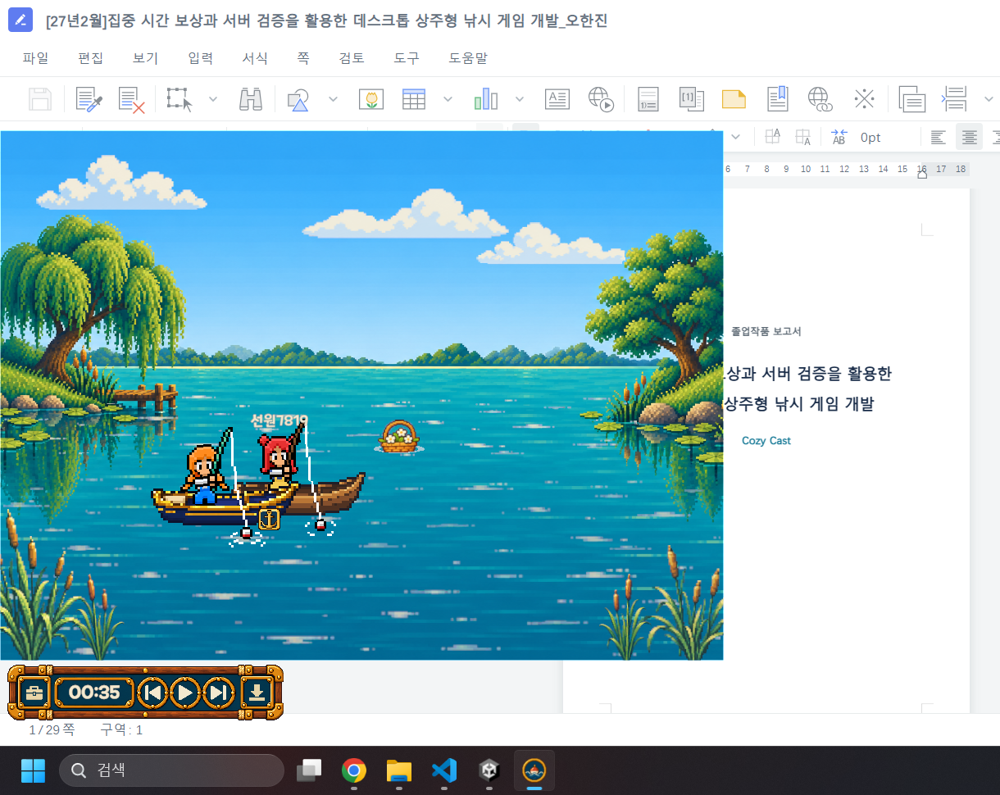

📄 **[졸업작품 보고서 (PDF, 38쪽)](docs/CozyCast_graduation_report.pdf)** — 시스템 구성, 보상 재현 검증 설계, 테스트 결과, 화면별 서비스 시나리오

<!-- 시연 영상 링크 추가 예정: [▶ 시연 영상 보기](https://youtu.be/...) -->

---

## 한눈에 보기

| 항목 | 내용 |
|---|---|
| 장르 | 데스크톱 상주형 코지 낚시 게임 (생산성 도구 내장) |
| 플랫폼 | Windows 10 · 11 (투명 오버레이 창) |
| 핵심 규칙 | 50분 항해 · 10 · 25 · 50분에 물고기 · 완주해 회항하면 입력 활동 비율에 따라 지급 |
| 개발 | 1인 개발 — 기획, 게임 클라이언트, 서버, 웹 대시보드, 배포 |
| 검증 | 서버 자동 테스트 73건 통과, Unity–서버 결과 일치 표본 3,000건, PC 2대 실제 빌드 시험 |

## 이런 게임입니다

**작업을 방해하지 않습니다.** 게임 창이 투명해서 그림이 없는 곳은 뒤의 작업 창을 그대로 클릭할 수 있습니다. 화면이 좁으면 작업표시줄 위 띠 모드나 최소화 바로 바꿉니다.

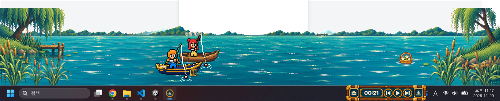

**집중한 시간이 보상이 됩니다.** 출항하면 연못 · 강 · 바다 중 한 곳으로 가고, 10 · 25 · 50분에 물고기가 잡힙니다. 키보드 · 마우스 입력이 없는 시간이 길면 지급 수가 줄어서, 켜 두기만 한 항해와 구분됩니다.

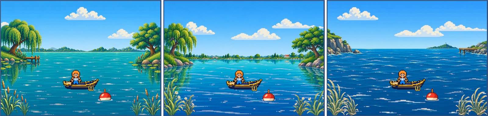

**함께 항해할 수 있습니다.** 최대 4명이 같은 바다에서 각자 작업하며, 채팅 없이 이모지로만 응원합니다. 함께 완주하면 경험치 보너스를 받습니다.

| 같은 바다의 동료 | 항해 결과 |
|---|---|
| 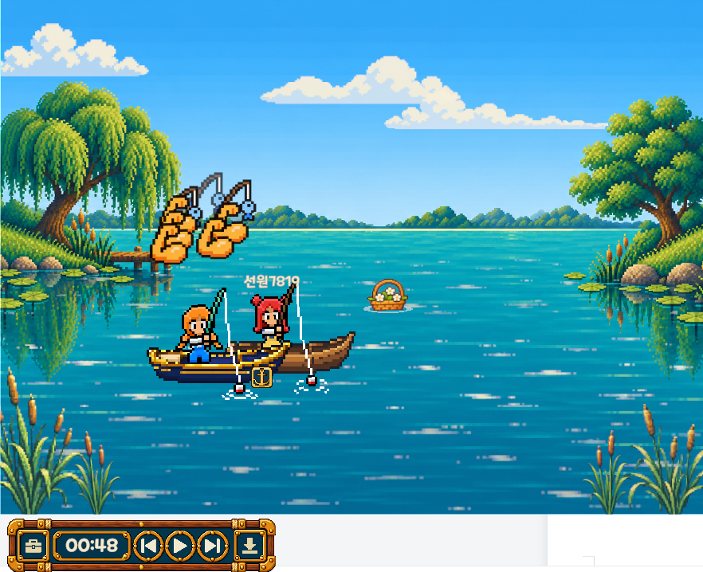 | 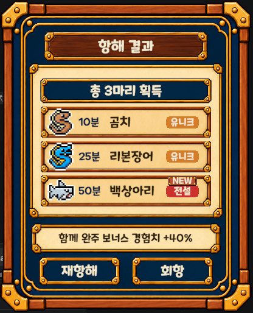 |

**모은 보상으로 꾸밉니다.** 물고기 40종 도감, 판매한 골드로 낚싯대 · 캐릭터 · 선실 · 배 꾸미기. 캐릭터 외형은 레이어를 실행 중에 합성해 모든 동작에 바로 반영됩니다. 로비 선실에서는 캐릭터가 가구에 앉거나 창밖을 보며 지냅니다.

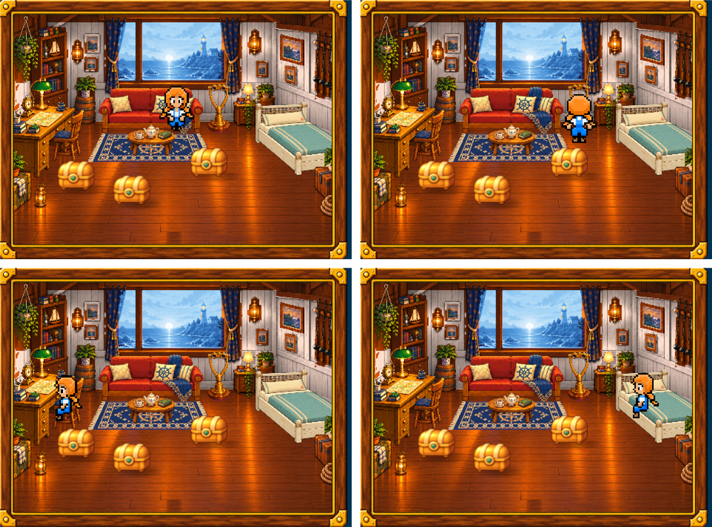
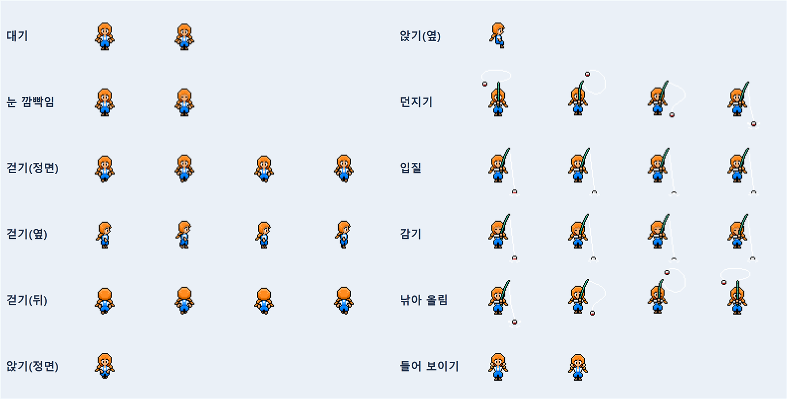
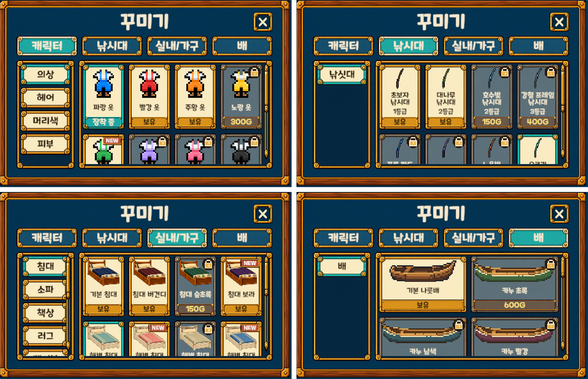

---

## 기술적으로 집중한 부분

### 1. 오프라인에서도 플레이되고, 서버가 결과를 다시 계산해 검증하는 보상 구조
- 결과를 서버가 정하면 인터넷이 끊길 때 게임이 멈추고, 게임이 정하면 조작할 수 있습니다.
- 그래서 **출항할 때 서버가 시드를 발급**하고, 게임은 그 시드로 네트워크 없이 물고기를 뽑습니다.
- 회항하면 서버가 같은 시드로 다시 계산해 **시간 → 개수 → 활동 → 물고기** 순서로 검사하고, 인증 · 미인증 · 거부로 기록합니다.
- 어디서 계산해도 같은 결과가 나오도록 했습니다.
  - **SplitMix64 난수기를 직접 구현:** 엔진과 런타임의 기본 난수기는 버전마다 결과가 달라질 수 있어서입니다.
  - **확률을 0.01% 단위 정수로 계산:** 부동소수점은 환경마다 마지막 자리가 달라질 수 있어서입니다.
  - **규칙 소스 파일 공유:** Unity와 서버가 같은 파일을 컴파일합니다(서버 csproj가 링크).
- Unity에서 뽑은 표본 3,000건을 서버 코드로 다시 계산해 모두 일치하는지 자동 테스트로 확인합니다.

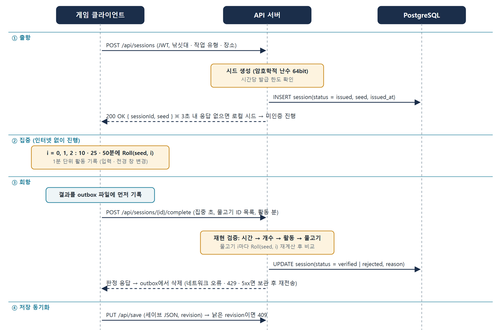

### 2. 투명 오버레이 창과 클릭 통과
- 마우스 아래 픽셀의 알파값이 0.1 미만이면 창 전체를 클릭 통과로 바꿉니다.
- 화면 모드를 바꿀 때 창 크기를 바꾸면 깜빡여서, 창 크기는 고정하고 창 안의 UI만 옮깁니다.
- 투명 창은 포커스가 없을 때 엔진 입력을 믿을 수 없어서, 창 끌기는 Windows 전역 마우스 상태로 추적합니다.

### 3. 기록이 사라지지 않는 오프라인 우선 동기화
- 회항 기록은 먼저 대기열 파일(아웃박스)에 쓰고, 서버가 처리했다는 응답을 받은 뒤에야 지웁니다.
- 같은 기록을 다시 보내도 한 번만 처리됩니다(멱등성).
- 로컬 저장은 임시 파일에 쓰고 검증한 뒤 교체하는 원자적 저장입니다.
- 클라우드 저장은 revision 번호로 다른 PC와의 충돌을 막습니다(409, 낙관적 동시성 제어).

### 4. 실시간 함께 항해 (SignalR)
- 배 좌표를 프레임마다 보내지 않고, 목적지와 낚시 단계가 바뀔 때만 보냅니다.
- 좌표는 0~1 비율 값이라 서로 다른 화면 모드에서도 같은 위치에 보입니다.
- 연결이 끊기면 자동으로 다시 연결해 같은 방에 재입장합니다.

### 5. 개인정보를 읽지 않는 작업 감지
- Windows API로 **마지막 입력 시각**과 **맨 앞 창이 바뀌었는지**만 확인합니다.
- 어떤 키를 눌렀는지와 창 제목은 읽지 않습니다.
- 서버에는 활동 시간(분)과 측정 시간(분), 두 숫자만 보냅니다.

### 6. 계정과 기기 이동
- 처음 실행하면 게스트 계정이 자동으로 만들어지고, 16자리 복구 코드로 다른 PC에서 이어 할 수 있습니다.
- 서버에는 복구 코드의 SHA-256 해시만 저장합니다.
- 이어 받으면 이전 기기의 토큰은 거절되고, 이전 기기가 켜져 있으면 즉시 알림을 받습니다.

---

## 시스템 구성

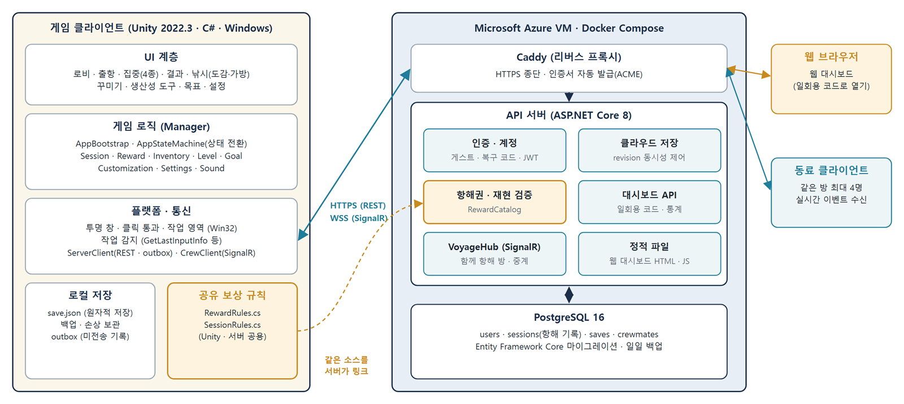

| 구성 | 기술 |
|---|---|
| 게임 클라이언트 | Unity 2022.3, C#, UniWindowController(투명 창), Microsoft SignalR 클라이언트 |
| API 서버 | ASP.NET Core 8 Minimal API, JWT(HMAC-SHA256) |
| 실시간 허브 | ASP.NET Core SignalR (방 최대 4명) |
| 데이터베이스 | PostgreSQL 16, Entity Framework Core 8 |
| 웹 대시보드 | HTML · CSS · JavaScript (프레임워크 없이 작성) |
| 배포 | Docker Compose, Caddy(HTTPS 자동 인증서), Azure VM |
| 테스트 | xUnit, Testcontainers(PostgreSQL 컨테이너 통합 테스트) |

**웹 대시보드:** 서버가 인증한 항해만 집계해 요일 × 시간대 집중 패턴, 추세, 작업 비율, 주간 순위를 보여 줍니다.

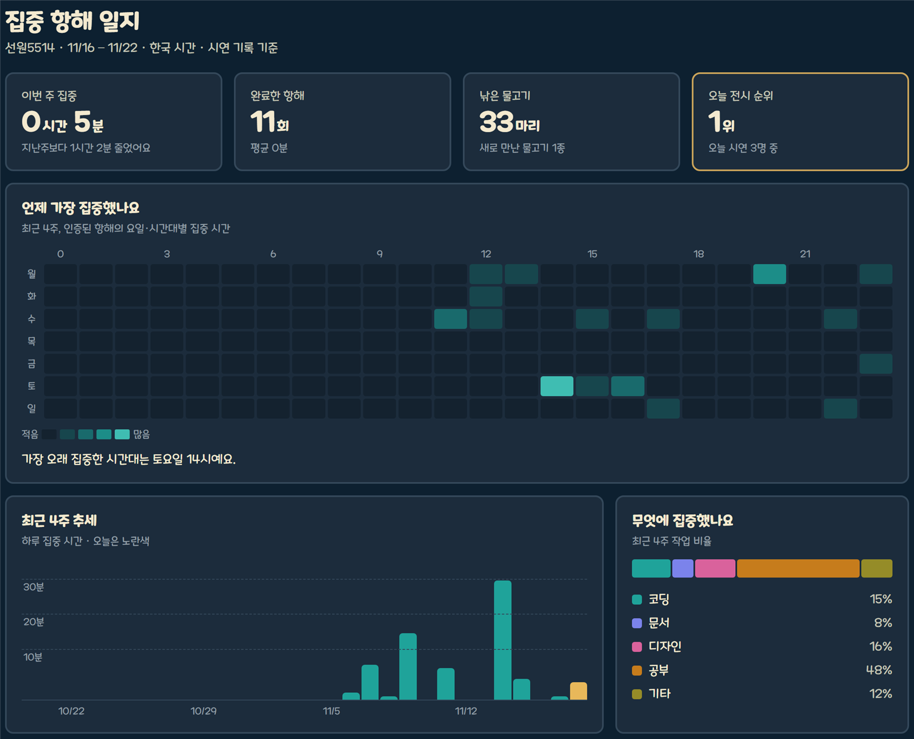

---

## 검증

| 구분 | 내용 | 결과 |
|---|---|---|
| 자동 | Unity–서버 보상 결과 일치(표본 3,000건), 희귀도 분포(등급별 20만 회), 거부 조건 | 통과 |
| 자동 | 계정 · 기기 이동 · 세이브 동시성 · 항해권 한도 · 오프라인 기록 · 대시보드 · 함께 항해 허브 (xUnit 73건) | 통과 |
| 수동 | 계정이 다른 PC 2대로 함께 항해(동료 표시 · 이모지 · 보너스) | 확인 |
| 수동 | PC 2대에서 복구 코드로 기기 이동 | 확인 |

## 전시

2026 졸업작품 전시회에서 포스터와 함께 노트북 · 모니터 두 화면으로 시연했습니다.

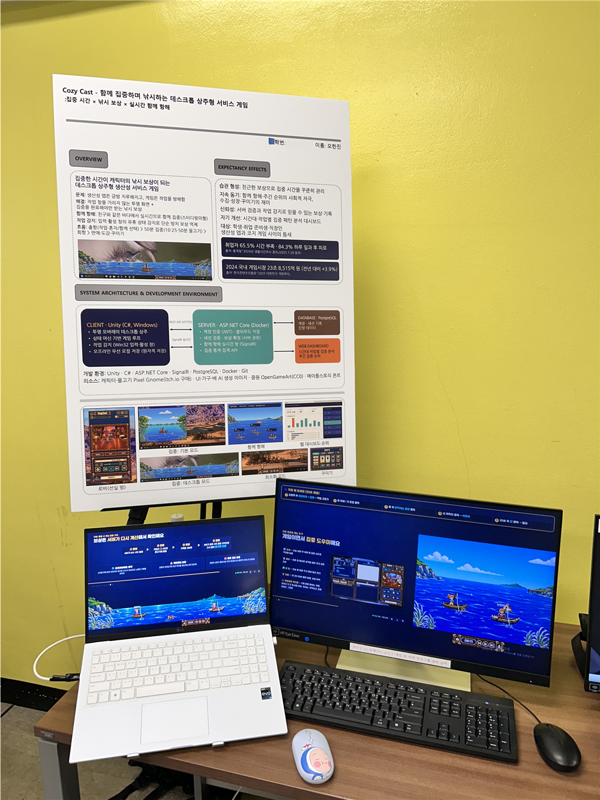

---

## 개발 방식

- 기획, 설계 결정, 실제 빌드 테스트(PC 2대 · 전시 환경)는 직접 했습니다.
- AI 코딩 도구(Claude, ChatGPT)는 구현과 조사를 보조하는 데 썼습니다. 제안된 원인과 수정은 재현 조건과 테스트로 확인한 뒤 반영했습니다.

## 사용한 리소스

- 캐릭터 · 물고기: Pixel Gnome 픽셀 아트 에셋(itch.io, 구매)
- 방 · 가구 · UI · 배 일부: ChatGPT 이미지 생성 후 보정
- 음원: 무료 음원(CC0 등, 게임 내 출처 창에 표기)
- 글꼴: 메이플스토리 서체

모든 에셋의 저작권은 각 제작자에게 있으며, 이 저장소에는 원본 에셋을 포함하지 않습니다.
